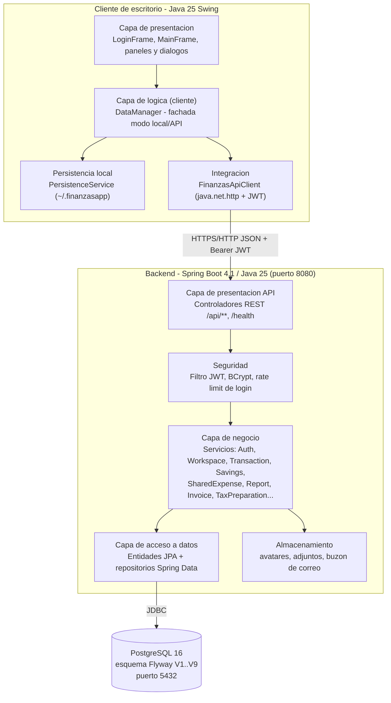
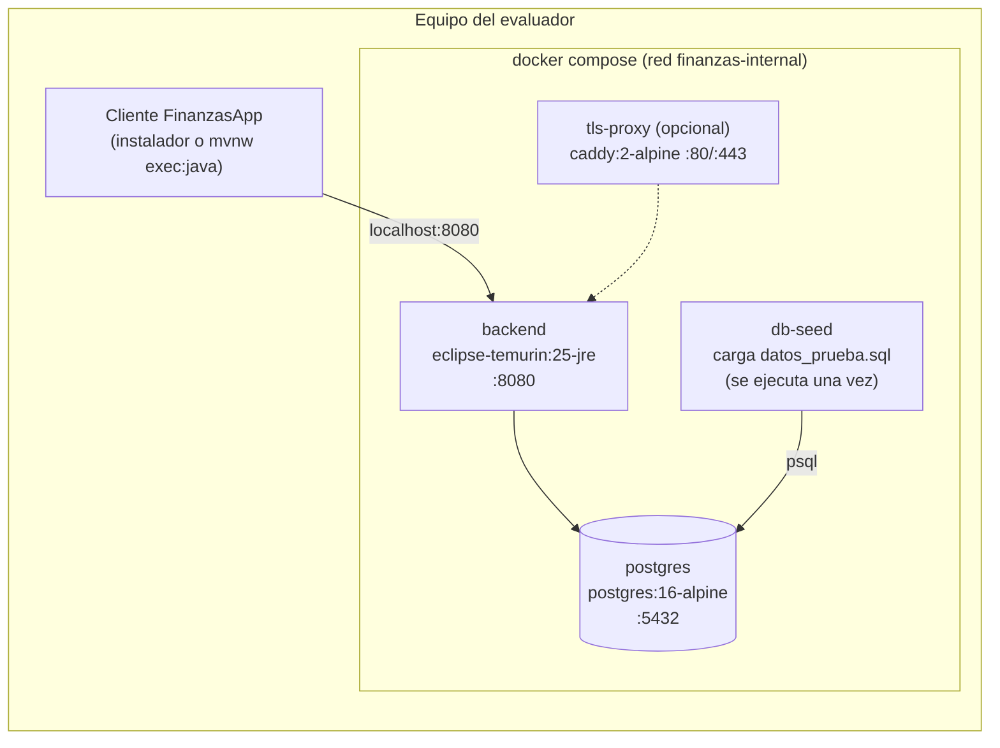
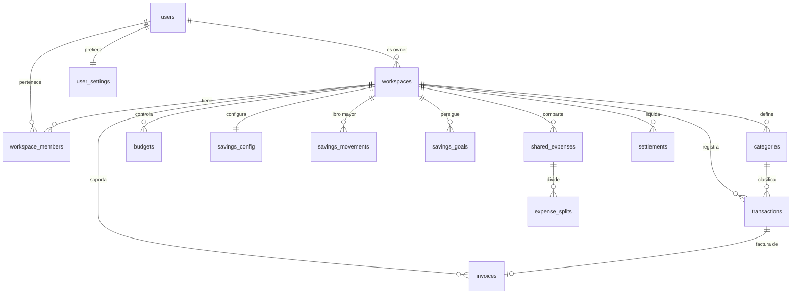

# FinanzasApp - Arquitectura del sistema y montaje del ambiente

Documento para que otro equipo pueda montar el ambiente, ejecutar la aplicacion y probarla.
Los pasos de instalacion paso a paso estan en el [README](../README.md).

## 1. Vista general

FinanzasApp es una aplicacion **cliente-servidor**:

- **Cliente de escritorio** (Java 25 Swing). Funciona en dos modos:
  - **Modo local**: sin servidor; guarda el estado serializado en `~/.finanzasapp` (o `FINANZAS_DATA_DIR`).
  - **Modo API**: se conecta por HTTP/JSON al backend; el backend es la fuente de verdad.
- **Backend REST** (Java 25 + Spring Boot 4.1) con autenticacion JWT, autorizacion por workspace y rol.
- **Base de datos** PostgreSQL 16, versionada con migraciones Flyway.
- **Almacenamiento de archivos** (avatares, adjuntos de facturas y buzon de correos) en un volumen.

### 1.1 Diagrama de componentes y capas



Version en texto (para visores sin Mermaid):

```text
+------------------------------ Cliente de escritorio (Java 25 Swing) ------------------------------+
|  Presentacion: LoginFrame, MainFrame, DashboardPanel, TransaccionesPanel, PresupuestoPanel, ...   |
|        |                                                                                          |
|  Logica cliente: DataManager (fachada) ----> PersistenceService (modo local, ~/.finanzasapp)      |
|        |                                                                                          |
|  Integracion: FinanzasApiClient (HTTP JSON, JWT, renovacion automatica de tokens)                |
+--------|-----------------------------------------------------------------------------------------+
         | HTTP :8080  /api/**
+--------v------------------------ Backend (Spring Boot 4.1, Java 25) -----------------------------+
|  Presentacion API: controladores REST (Auth, Workspace, Transaction, Budget, Savings, ...)        |
|  Seguridad: filtro JWT, BCrypt(12), limite de intentos de login, autorizacion por workspace/rol    |
|  Negocio: servicios de aplicacion (ahorro con libro mayor, gastos compartidos, reportes, ...)    |
|  Datos: entidades JPA + repositorios Spring Data          Archivos: /app/storage (volumen)        |
+--------|-----------------------------------------------------------------------------------------+
         | JDBC :5432
+--------v--------+
| PostgreSQL 16   |  esquema creado por Flyway (V1..V9) o por database/crear_bd.sql
+-----------------+
```

### 1.2 Despliegue con Docker Compose



Orden de arranque: `postgres` (healthy) -> `backend` aplica migraciones Flyway y queda healthy -> `db-seed` inserta los datos de prueba y termina con codigo 0.

## 2. Tecnologias y versiones

| Componente | Tecnologia | Version |
|---|---|---|
| Lenguaje (cliente y backend) | Java (OpenJDK / Eclipse Temurin) | 25 |
| Interfaz de escritorio | Java Swing (incluido en el JDK) | JDK 25 |
| Framework backend | Spring Boot | 4.1.0 |
| Spring Framework (core, webmvc) | Spring | 7.0.8 |
| Seguridad | Spring Security / Nimbus JOSE JWT | 7.1.0 / 10.9 |
| Persistencia | Spring Data JPA / Hibernate ORM | 4.1.0 / 7.4.1.Final |
| Migraciones | Flyway (core + database-postgresql) | 12.4.0 |
| Driver de BD | PostgreSQL JDBC | 42.7.11 |
| Base de datos | PostgreSQL (imagen `postgres:16-alpine`) | 16 |
| Servidor de aplicaciones | Apache Tomcat embebido | 11.0.22 |
| Serializacion JSON | Jackson databind | 2.21.4 / 3.1.4 |
| Construccion | Apache Maven (via Maven Wrapper `mvnw`) | 3.9.16 |
| Pruebas | JUnit Jupiter / Testcontainers | 5.10.2 (cliente), Boot BOM (backend) / 1.21.3 |
| Cobertura | JaCoCo | 0.8.13 |
| Contenedores | Docker Engine / Docker Compose | 24+ / v2+ (probado con 29.4.2 / v5.1.3) |
| Proxy TLS opcional | Caddy | 2 |
| Integracion continua | GitHub Actions | `.github/workflows/ci.yml` |
| Sistema operativo probado | Windows 11 (cliente y Docker Desktop) | - |

## 3. Dependencias

### 3.1 Backend (`finanzas-backend/pom.xml`)

Gestionadas por el parent `spring-boot-starter-parent:4.1.0` (las versiones efectivas estan en la tabla anterior):

| Dependencia | Uso |
|---|---|
| `spring-boot-starter-webmvc` | API REST y Tomcat embebido |
| `spring-boot-starter-security` | Autenticacion y autorizacion |
| `spring-boot-starter-data-jpa` | Entidades JPA, repositorios, Hibernate |
| `spring-boot-starter-validation` | Validacion de DTOs (`@NotBlank`, `@Email`, `@Size`) |
| `spring-boot-starter-actuator` | Health/metrics |
| `spring-boot-starter-flyway` + `flyway-database-postgresql` | Migraciones automaticas al arrancar |
| `spring-security-oauth2-jose` | Emision y validacion de JWT |
| `jackson-databind` | JSON |
| `org.postgresql:postgresql` (runtime) | Driver JDBC |
| `spring-boot-starter-test`, `spring-security-test`, `testcontainers` (test) | Pruebas |

Las dependencias se descargan automaticamente con `mvnw` (o dentro de la imagen Docker); no hay que instalarlas a mano.

### 3.2 Cliente (`pom.xml`)

El cliente **no tiene dependencias de ejecucion** externas: usa solo el JDK 25 (Swing, `java.net.http`, `java.util.zip`). En pruebas usa `junit-jupiter 5.10.2`.

## 4. Puertos

| Servicio | Puerto | Variable para cambiarlo |
|---|---|---|
| PostgreSQL | 5432 | `POSTGRES_PORT` (puerto publicado en el host) |
| Backend REST | 8080 | `BACKEND_PORT` (host) / `PORT` (dentro del contenedor) |
| Proxy TLS (opcional) | 80 / 443 | perfil `tls-proxy` |

## 5. Variables de entorno

Archivo de ejemplo: [`.env.example`](../.env.example). Copielo a `.env` en la raiz del proyecto (Docker Compose lo lee automaticamente). **Nunca** suba `.env` al repositorio.

### 5.1 Backend

| Variable | Valor por defecto | Descripcion |
|---|---|---|
| `SPRING_PROFILES_ACTIVE` | `dev` | Perfil: `dev`, `test` o `prod` (`prod` exige secretos fuertes). |
| `PORT` | `8080` | Puerto HTTP del backend. |
| `FINANZAS_DB_URL` | `jdbc:postgresql://localhost:5432/finanzas` | URL JDBC. En Compose: `jdbc:postgresql://postgres:5432/finanzas`. |
| `POSTGRES_USER` | `finanzas` | Usuario de la BD (lo usan Postgres y el backend). |
| `POSTGRES_PASSWORD` | `finanzas_dev_password` (Compose) | Clave de la BD. |
| `POSTGRES_DB` | `finanzas` | Nombre de la BD (Compose). |
| `FINANZAS_JWT_SECRET` | valor de desarrollo | Secreto HMAC del JWT. Minimo 32 caracteres (48 en `prod`). |
| `FINANZAS_ACCESS_TOKEN_MINUTES` | `15` | Vigencia del token de acceso. |
| `FINANZAS_REFRESH_TOKEN_DAYS` | `14` | Vigencia del token de refresco. |
| `FINANZAS_PUBLIC_BASE_URL` | `http://localhost:8080` | URL publica usada en enlaces de correos. |
| `FINANZAS_EMAIL_VERIFICATION_HOURS` | `48` | Vigencia del enlace de verificacion de correo. |
| `FINANZAS_PASSWORD_RESET_MINUTES` | `30` | Vigencia del token de recuperacion. |
| `FINANZAS_EMAIL_MODE` | `file` | `file` (escribe correos en disco), `log` o `disabled`. |
| `FINANZAS_EMAIL_SINK_DIR` | `./storage/mail` (`/app/storage/mail` en Docker) | Carpeta donde quedan los correos simulados. |
| `FINANZAS_STORAGE_DIR` | `./storage` (`/app/storage` en Docker) | Avatares y adjuntos. |
| `FINANZAS_MAX_FILE_SIZE` / `FINANZAS_MAX_REQUEST_SIZE` | `5MB` / `6MB` | Limites de carga de archivos. |
| `GOOGLE_OAUTH_CLIENT_ID` | vacio | Opcional: inicio de sesion con Google. |
| `SPRING_FLYWAY_BASELINE_ON_MIGRATE` / `SPRING_FLYWAY_BASELINE_VERSION` | no definidas | Solo si la BD se creo con `crear_bd.sql`: `true` / `9`. |

### 5.2 Cliente de escritorio

| Variable | Valor por defecto | Descripcion |
|---|---|---|
| `FINANZAS_API_ENABLED` | `false` | `true` para usar el backend (modo API); `false` para modo local. |
| `FINANZAS_API_BASE_URL` | `http://localhost:8080` | URL del backend. |
| `FINANZAS_DATA_DIR` | `~/.finanzasapp` | Carpeta del estado local y caches. |
| `FINANZAS_DEMO_MODE` | `false` | `true` crea el usuario local de demostracion (solo modo local). |
| `FINANZAS_SYNC_POLL_SECONDS` | `20` | Frecuencia de sincronizacion con el backend (minimo 5). |
| `GOOGLE_OAUTH_CLIENT_ID` | vacio | Opcional: Google Sign-In. |

### 5.3 Ejemplo de `.env` para pruebas

```dotenv
SPRING_PROFILES_ACTIVE=dev
POSTGRES_DB=finanzas
POSTGRES_USER=finanzas
POSTGRES_PASSWORD=finanzas_dev_password
POSTGRES_PORT=5432
BACKEND_PORT=8080
FINANZAS_JWT_SECRET=cambie-este-secreto-de-desarrollo-de-al-menos-32-caracteres
FINANZAS_PUBLIC_BASE_URL=http://localhost:8080
FINANZAS_EMAIL_MODE=file
```

## 6. Base de datos

### 6.1 Scripts

| Archivo | Contenido | Cuando usarlo |
|---|---|---|
| [`database/crear_bd.sql`](../database/crear_bd.sql) | Esquema completo (migraciones V1..V9) + datos de prueba. | Montaje **manual** en un PostgreSQL 16 existente. |
| [`database/datos_prueba.sql`](../database/datos_prueba.sql) | Solo datos de prueba (idempotente). | Despues de que el backend creo el esquema con Flyway. Docker Compose lo ejecuta solo (servicio `db-seed`). |
| `finanzas-backend/src/main/resources/db/migration/V*.sql` | Migraciones Flyway versionadas. | Las aplica el backend automaticamente al arrancar. |
| [`scripts/generate-crear-bd.ps1`](../scripts/generate-crear-bd.ps1) | Regenera `crear_bd.sql` a partir de las migraciones y los datos. | Si se agrega una migracion. |

Montaje manual con `psql`:

```bash
createdb -h localhost -U postgres finanzas            # o: CREATE DATABASE finanzas;
psql -h localhost -p 5432 -U finanzas -d finanzas -v ON_ERROR_STOP=1 -f database/crear_bd.sql
```

Si luego se arranca el backend sobre esa base, defina `SPRING_FLYWAY_BASELINE_ON_MIGRATE=true` y `SPRING_FLYWAY_BASELINE_VERSION=9` para que Flyway reconozca el esquema existente (verificado: el backend arranca y el login de prueba responde 200).

### 6.2 Modelo de datos (tablas principales)

| Tabla | Proposito |
|---|---|
| `users`, `user_settings` | Cuentas (hash BCrypt), perfil y preferencias (tema, locale, zona horaria, formato monetario). |
| `refresh_tokens`, `account_tokens` | Sesiones (hash del token) y tokens de verificacion/recuperacion. |
| `workspaces`, `workspace_members`, `workspace_invitations` | Espacios personal/hogar/negocio, roles OWNER/ADMIN/MEMBER/VIEWER e invitaciones. |
| `categories` | Categorias de ingreso/gasto por workspace (archivables). |
| `transactions` | Ingresos y gastos (`NUMERIC(19,2)`, monto > 0). |
| `budgets` | Presupuesto mensual por categoria. |
| `savings_config`, `savings_movements` | Configuracion de ahorro y libro mayor inmutable con clave de idempotencia. |
| `savings_goals` | Metas de ahorro. |
| `recurring_transactions` | Movimientos recurrentes. |
| `shared_expenses`, `expense_splits`, `settlements` | Gastos compartidos, partes por miembro y liquidaciones. |
| `invoices`, `tax_configurations` | Facturas con adjunto y configuracion UVT para la preparacion DIAN. |
| `notifications`, `audit_logs` | Notificaciones y auditoria por workspace. |



### 6.3 Datos y usuarios de prueba

Todos con la contrasena **`Prueba2026*`**:

| Usuario | Rol en "Hogar Gomez" | Para probar |
|---|---|---|
| `ana.duena@finanzasapp.test` | OWNER | Todo: miembros, invitaciones, presupuestos, metas, facturas, reportes. |
| `carlos.miembro@finanzasapp.test` | MEMBER | Registrar transacciones y gastos compartidos; no puede administrar miembros. |
| `laura.lectora@finanzasapp.test` | VIEWER | Solo lectura: cualquier creacion/edicion responde 403. |

Datos cargados en "Hogar Gomez" (fechas relativas a la fecha de carga): 11 transacciones (mes anterior y mes actual), ahorro automatico del 20% con su libro mayor, 4 presupuestos del mes (Entretenimiento excedido a proposito), 2 metas, 1 recurrencia mensual, 1 gasto compartido de 300.000 dividido entre Ana y Carlos, 1 factura y 1 notificacion. Cada usuario tiene ademas su workspace personal "Mi espacio" con las 14 categorias por defecto.

Modo local (sin backend): con `FINANZAS_DEMO_MODE=true` el cliente crea `samuel@finanzasapp.com` / `123456` con transacciones y metas de ejemplo.

## 7. Verificacion del ambiente

```bash
docker compose ps -a                    # postgres y backend "healthy"; db-seed "Exited (0)"
curl http://localhost:8080/health/readiness
# {"status":"UP","database":"UP"}
curl -X POST http://localhost:8080/api/auth/login -H "Content-Type: application/json" \
     -d '{"email":"ana.duena@finanzasapp.test","password":"Prueba2026*"}'
# 200 con {"accessToken": "...", "refreshToken": "...", ...}
```

La especificacion completa de la API esta en [`docs/API.md`](API.md) y en el OpenAPI del backend.

## 8. Seguridad (resumen)

- Contrasenas con BCrypt (costo 12) en el backend y PBKDF2 en modo local.
- JWT de acceso de 15 minutos; refresh tokens rotados, guardados como hash y revocables.
- Cada endpoint `/api/workspaces/{id}/**` valida la membresia y el rol; un VIEWER no puede modificar datos.
- Limite de intentos fallidos de inicio de sesion (HTTP 429).
- Validacion de tipo real y tamano de avatares y adjuntos; proteccion de ZIP de respaldo contra path traversal y exceso de tamano.
- Secretos solo por variables de entorno; el perfil `prod` rechaza secretos debiles.

Mas detalle: [`docs/SECURITY.md`](SECURITY.md), [`docs/DEPLOYMENT.md`](DEPLOYMENT.md).
