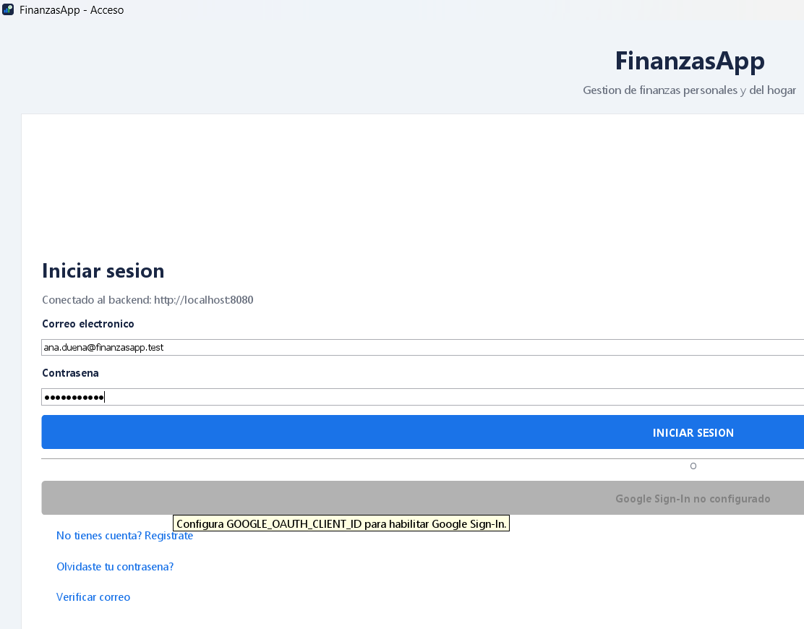
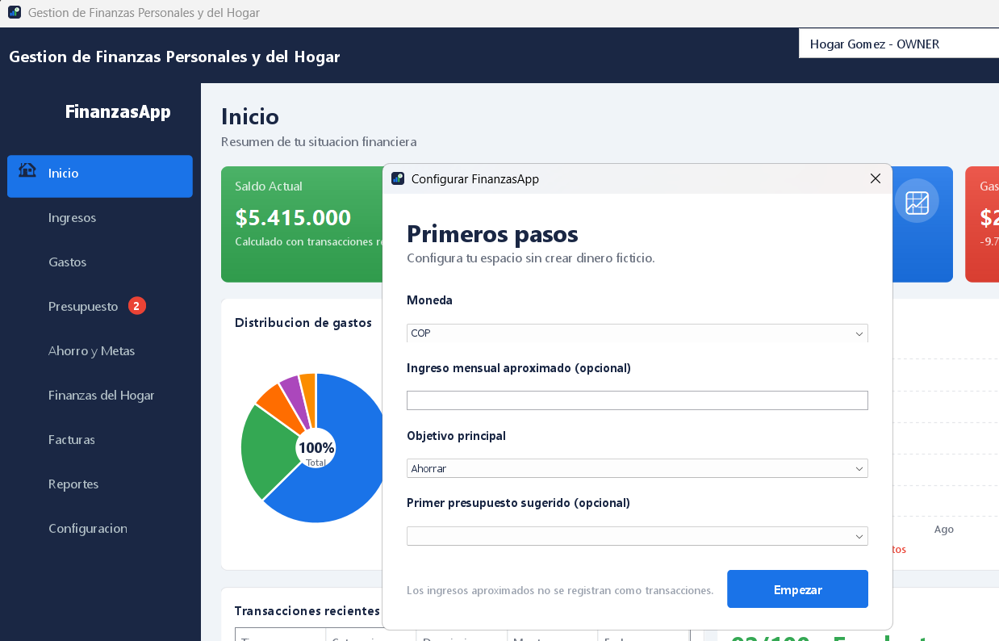
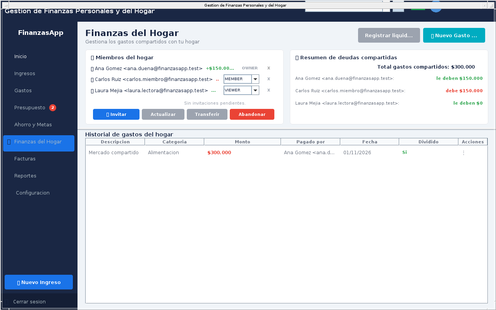

# FinanzasApp - Manual de instalacion paso a paso

**Proyecto:** FinanzasApp - Gestion de finanzas personales y del hogar
**Autor:** Juan Jose Roman Bedoya - Aseguramiento de la Calidad del Software, UNIMINUTO (2026-2)
**Repositorio:** https://github.com/juan2052H/FinanzasApp

Este manual esta escrito para personas que **nunca han instalado un programa de este tipo**. Siga los pasos en orden, sin saltarse ninguno. Cada comando se puede copiar y pegar tal cual. Tiempo aproximado la primera vez: **30 a 60 minutos** (la mayor parte es esperar descargas).

## Acceso rapido - usuario y contrasena

| Usuario (correo) | Contrasena | Rol | Donde se usa |
|---|---|---|---|
| **`ana.duena@finanzasapp.test`** | **`Prueba2026*`** | Duena del hogar (OWNER) | Acceso directo "FinanzasApp (servidor)" |
| **`carlos.miembro@finanzasapp.test`** | **`Prueba2026*`** | Miembro (MEMBER) | Acceso directo "FinanzasApp (servidor)" |
| **`laura.lectora@finanzasapp.test`** | **`Prueba2026*`** | Solo lectura (VIEWER) | Acceso directo "FinanzasApp (servidor)" |
| **`samuel@finanzasapp.com`** | **`123456`** | Demo sin servidor | Acceso directo "FinanzasApp" (Parte 7) |

> **IMPORTANTE:** la contrasena **`Prueba2026*`** termina en asterisco (*). El asterisco es parte de la contrasena: escribala completa, con la P mayuscula.
> Las tres primeras cuentas solo funcionan si el servidor esta encendido (Parte 4).

---

# Parte 0. Conceptos basicos (lea esto primero)

| Palabra | Que significa en este manual |
|---|---|
| **Aplicacion** | El programa FinanzasApp que se abre en una ventana, como cualquier programa de Windows. Se instala con `FinanzasApp-Setup.exe`. |
| **Servidor** | Un programa que corre "por detras" y guarda los datos de prueba (usuarios, gastos, hogar). La aplicacion se conecta a el. Se enciende con Docker. |
| **Docker / Docker Desktop** | Programa gratuito que permite encender el servidor y su base de datos con un solo comando, sin instalarlos uno por uno. |
| **PowerShell** | Ventana de texto de Windows (fondo azul o negro) donde se escriben **comandos**. Viene incluida en Windows. |
| **Comando** | Una linea de texto que se escribe (o pega) en PowerShell y se ejecuta con la tecla **Enter**. En este manual aparecen en recuadros grises. |
| **Carpeta del proyecto** | La carpeta `C:\FinanzasApp\FinanzasApp`, donde queda el codigo despues de descomprimir (Parte 3). |

**Como pegar un comando en PowerShell:** copie el texto del recuadro gris (seleccionar y Ctrl+C), haga clic dentro de la ventana de PowerShell y pulse **clic derecho** (o Ctrl+V). Luego pulse **Enter**.

**Resumen de lo que va a hacer:**

1. Revisar que el computador sirve (Parte 1).
2. Instalar Docker Desktop (Parte 2) - solo la primera vez.
3. Descomprimir los archivos del proyecto (Parte 3) - solo la primera vez.
4. Encender el servidor con un comando (Parte 4).
5. Instalar la aplicacion (Parte 5) - solo la primera vez.
6. Abrir la aplicacion e iniciar sesion con las cuentas de prueba (Parte 6).

---

# Parte 1. Revisar que el computador cumple los requisitos

## 1.1 Requisitos

| Recurso | Minimo | Recomendado |
|---|---|---|
| Sistema operativo | Windows 10 (version 22H2) u 11, de 64 bits | Windows 11 |
| Procesador | 64 bits, 2 nucleos, con **virtualizacion activada** | 4 nucleos |
| Memoria RAM | 8 GB | 16 GB |
| Espacio libre en disco | 10 GB | 15 GB |
| Pantalla | 1280 x 720 | 1920 x 1080 |
| Internet | Necesario la primera vez (se descargan unos 2 GB) | - |
| Permisos | Una cuenta de administrador para instalar Docker (solo una vez) | - |

No necesita instalar Java, Maven ni PostgreSQL: el instalador y Docker los traen incluidos.

## 1.2 Ver la version de Windows, la memoria RAM y el disco

1. Pulse las teclas **Windows + R**, escriba `winver` y pulse **Enter**. La ventana debe decir *Windows 10 Version 22H2* o *Windows 11*. Cierrela.
2. Pulse **Windows + Pausa** (o vaya a *Configuracion > Sistema > Informacion*). Revise **RAM instalada** (8 GB o mas) y **Tipo de sistema: sistema operativo de 64 bits**.
3. Abra el **Explorador de archivos** (Windows + E), haga clic en **Este equipo** y revise que el disco **C:** tenga al menos 10 GB libres.

## 1.3 Ver si la virtualizacion esta activada

1. Pulse **Ctrl + Shift + Esc** para abrir el **Administrador de tareas**.
2. Vaya a la pestana **Rendimiento** y haga clic en **CPU**.
3. Abajo a la derecha debe decir **Virtualizacion: Habilitado**.

> Si dice **Deshabilitado**, debe activarla en la BIOS del computador (la opcion se llama *Intel VT-x*, *Intel Virtualization Technology*, *AMD-V* o *SVM Mode*). Como entrar a la BIOS depende de la marca (normalmente pulsando F2, F10, F12 o Supr al encender). Si no sabe hacerlo, pida ayuda: sin virtualizacion Docker no funciona. Puede probar mientras tanto el modo sin servidor (Parte 7).

---

# Parte 2. Instalar Docker Desktop (solo la primera vez)

Si Docker Desktop ya esta instalado, salte a la seccion 2.4 para comprobarlo.

## 2.1 Activar WSL 2 (componente de Windows que necesita Docker)

1. Haga clic en el boton **Inicio**, escriba `PowerShell`.
2. Sobre **Windows PowerShell** haga **clic derecho > Ejecutar como administrador** y acepte el aviso de Windows con **Si**.
3. Pegue este comando y pulse **Enter**:

```powershell
wsl --install
```

4. Espere a que termine (puede tardar varios minutos). Si al final pide reiniciar, **reinicie el computador**.
5. Si dice que WSL ya esta instalado, ejecute este otro comando para actualizarlo:

```powershell
wsl --update
```

## 2.2 Descargar e instalar Docker Desktop

1. Abra el navegador y entre a: https://www.docker.com/products/docker-desktop/
2. Pulse **Download for Windows - AMD64** (o *Download Docker Desktop*). Se descarga `Docker Desktop Installer.exe` (unos 500 MB).
3. Abra el archivo descargado (doble clic). Si Windows pregunta si permite cambios, pulse **Si**.
4. En la pantalla de configuracion deje marcada la opcion **Use WSL 2 instead of Hyper-V (recommended)** y pulse **Ok**.
5. Espere a que termine y pulse **Close and restart** (el computador se reinicia).

## 2.3 Abrir Docker Desktop por primera vez

1. Despues del reinicio, abra **Docker Desktop** desde el menu Inicio (si no se abrio solo).
2. Acepte el acuerdo de servicio (**Accept**). El uso educativo y personal es gratuito.
3. Si pide iniciar sesion o responder una encuesta, puede pulsar **Skip** / **Continue without signing in**: no es necesario tener cuenta.
4. Espere a que, abajo a la izquierda, aparezca **Engine running** con un punto verde.

> Cada vez que quiera usar FinanzasApp con el servidor, **Docker Desktop debe estar abierto** y mostrar *Engine running*.

## 2.4 Comprobar que Docker funciona

1. Abra **PowerShell normal** (Inicio > escriba `PowerShell` > clic en **Windows PowerShell**; esta vez no hace falta administrador).
2. Pegue estos comandos, uno por uno, pulsando **Enter** despues de cada uno:

```powershell
docker --version
docker compose version
```

Debe aparecer algo parecido a esto (los numeros pueden variar):

```text
Docker version 29.4.2, build ...
Docker Compose version v5.1.3
```

> Si aparece *"docker" no se reconoce como nombre de un cmdlet...*, cierre PowerShell y vuelva a abrirlo; si sigue igual, Docker Desktop no quedo instalado (repita 2.2).

---

# Parte 3. Preparar los archivos del proyecto (solo la primera vez)

Va a usar el archivo de entrega **`FinanzasApp_Entrega_Final.zip`**.

## 3.1 Descomprimir la entrega

1. Cree la carpeta `C:\FinanzasApp`: abra el Explorador de archivos (Windows + E), entre a **Disco local (C:)**, clic derecho en un espacio vacio > **Nuevo > Carpeta** y nombrela `FinanzasApp`.
2. Haga **clic derecho** sobre `FinanzasApp_Entrega_Final.zip` > **Extraer todo...**
3. En *"Los archivos se extraeran en esta carpeta"* escriba `C:\FinanzasApp` y pulse **Extraer**.
4. Se crea la carpeta `C:\FinanzasApp\FinanzasApp_Entrega_Final` con estos archivos:

| Archivo | Para que sirve |
|---|---|
| `FinanzasApp-Setup.exe` | Instalador de la aplicacion (Parte 5) |
| `FinanzasApp-codigo-fuente.zip` | Codigo del proyecto, necesario para encender el servidor (3.2) |
| `REQUISITOS_E_INSTALACION.docx` | Este manual |
| `GUIA_EVALUADOR.md` | Lista de verificacion para probar la aplicacion |
| `FinanzasApp_Formato_Calidad_Final.xlsx` | Requisitos, casos de prueba y defectos del proyecto |
| `ARQUITECTURA_Y_AMBIENTE.md`, `crear_bd.sql`, `env.example`, `README.md`, `LEEME.txt` | Documentacion tecnica |

## 3.2 Descomprimir el codigo fuente

1. Entre a `C:\FinanzasApp\FinanzasApp_Entrega_Final`.
2. Clic derecho en **`FinanzasApp-codigo-fuente.zip`** > **Extraer todo...**
3. Escriba `C:\FinanzasApp` como destino y pulse **Extraer**.
4. Debe quedar la carpeta **`C:\FinanzasApp\FinanzasApp`** con archivos como `docker-compose.yml`, `README.md` y las carpetas `database`, `docs`, `src`.

> Use exactamente la ruta `C:\FinanzasApp`. Las rutas muy largas o dentro de OneDrive pueden causar errores en Windows.

**Alternativa sin el ZIP:** en https://github.com/juan2052H/FinanzasApp pulse **Code > Download ZIP** y descomprimalo en `C:\FinanzasApp`. En ese caso la carpeta se llama `C:\FinanzasApp\FinanzasApp-main` y debe usar ese nombre en los comandos.

---

# Parte 4. Encender el servidor

Haga esta parte **cada vez** que vaya a usar la aplicacion con las cuentas de prueba.

## 4.1 Abrir PowerShell en la carpeta del proyecto

1. Asegurese de que **Docker Desktop** este abierto y diga **Engine running**.
2. Abra **Windows PowerShell** (Inicio > escriba `PowerShell` > Enter).
3. Pegue este comando para entrar a la carpeta del proyecto:

```powershell
cd C:\FinanzasApp\FinanzasApp
```

4. Compruebe que esta en la carpeta correcta con este comando:

```powershell
Test-Path docker-compose.yml
```

Debe responder **`True`**. Si responde `False`, la carpeta no es la correcta: revise la Parte 3.2.

## 4.2 Encender el servidor

Pegue este comando y pulse **Enter**:

```powershell
docker compose up -d --build
```

- **La primera vez tarda entre 5 y 15 minutos** (descarga y prepara todo). Veran muchas lineas pasar: es normal. **No cierre la ventana.**
- Las siguientes veces tarda segundos.

Al terminar, las ultimas lineas deben ser parecidas a estas:

```text
 Container finanzas-postgres  Healthy
 Container finanzas-backend   Healthy
 Container finanzasapp-db-seed-1  Started
```

## 4.3 Comprobar que el servidor esta listo

Espere unos 30 segundos y pegue:

```powershell
docker compose ps -a
```

Mire la columna **STATUS** (estado). Debe verse asi:

| NAME (nombre) | STATUS (estado) | Que significa |
|---|---|---|
| `finanzas-postgres` | `Up ... (healthy)` | La base de datos esta encendida y sana |
| `finanzas-backend` | `Up ... (healthy)` | El servidor esta encendido y sano |
| `finanzasapp-db-seed-1` | `Exited (0) ...` | Ya cargo las cuentas de prueba y termino. **Es normal que diga Exited (0).** |

> Si `finanzas-backend` dice `(health: starting)`, espere un minuto y repita el comando. Si `db-seed` dice `Exited (1)` o algo distinto de `(0)`, vaya a la Parte 10.

Ultima comprobacion (opcional): abra el navegador y entre a http://localhost:8080/health/readiness . Debe mostrar:

```text
{"status":"UP","database":"UP"}
```

**Puede cerrar PowerShell:** el servidor sigue encendido mientras Docker Desktop este abierto.

---

# Parte 5. Instalar la aplicacion (solo la primera vez)

1. Entre a `C:\FinanzasApp\FinanzasApp_Entrega_Final` y haga **doble clic** en **`FinanzasApp-Setup.exe`**.
2. Si aparece **"Windows protegio su PC"** (SmartScreen): pulse **Mas informacion** y luego **Ejecutar de todas formas**. Aparece porque el instalador no tiene firma digital comercial; es seguro.
3. A la pregunta **"Instalar FinanzasApp en este equipo?"** responda **Si**.
4. Espere entre 10 y 30 segundos (no se ve una barra de progreso). Aparecera el mensaje **"FinanzasApp 2.0.0 se instalo correctamente"**. Pulse **Aceptar**.

La instalacion **no necesita permisos de administrador** y ya incluye Java. Se crean dos accesos directos en el **Escritorio** y en el **menu Inicio > FinanzasApp**:

| Acceso directo | Para que sirve |
|---|---|
| **FinanzasApp (servidor)** | **Use este para las pruebas.** Se conecta al servidor y ve las cuentas de prueba (ana, carlos, laura). |
| **FinanzasApp** | Modo local sin servidor: guarda los datos solo en este PC y **no** ve las cuentas de prueba (ver Parte 7). |

---

# Parte 6. Abrir la aplicacion e iniciar sesion

1. Haga doble clic en **FinanzasApp (servidor)** (Escritorio o menu Inicio).
2. Se abre la pantalla de acceso. Debajo de *Iniciar sesion* debe decir **"Conectado al backend: http://localhost:8080"**. Si no lo dice, abrio el acceso directo equivocado.
3. En **Correo electronico** escriba `ana.duena@finanzasapp.test`
4. En **Contrasena** escriba `Prueba2026*` (con el asterisco al final).
5. Pulse **Enter** o el boton **INICIAR SESION**.



6. La primera vez en cada computador aparece la ventana **"Primeros pasos"**. Deje los campos opcionales vacios y pulse **Empezar**.



7. Listo: vera el panel **Inicio** del hogar **"Hogar Gomez"** con **Saldo Actual $5.415.000**, la grafica de gastos y las transacciones recientes.

- El menu de la izquierda lleva a cada seccion: Ingresos, Gastos, Presupuesto, Ahorro y Metas, Finanzas del Hogar, Facturas, Reportes y Configuracion.
- El selector de **arriba a la derecha** cambia entre **"Hogar Gomez"** (donde estan los datos de prueba) y **"Mi espacio"** (espacio personal, vacio).
- Para cambiar de usuario: **Cerrar sesion** (abajo a la izquierda) y entrar con otra cuenta.

---

# Parte 7. Usar la aplicacion sin servidor (opcional)

Sirve si Docker no funciona en su computador. **En este modo no existen las cuentas ana, carlos ni laura.**

- **Opcion A - crear su propia cuenta:** abra **FinanzasApp** (sin "servidor"), pulse **"No tienes cuenta? Registrate"**, llene el formulario, marque *Acepto terminos y condiciones* y pulse **CREAR CUENTA**.
- **Opcion B - cuenta de demostracion `samuel@finanzasapp.com` / `123456`:** solo funciona si nunca se ha abierto el modo local en ese PC. Abra PowerShell, pegue el comando, **cierre sesion de Windows y vuelva a entrar**, y abra **FinanzasApp**:

```powershell
setx FINANZAS_DEMO_MODE true
```

---

# Parte 8. Que deberia ver (verificacion rapida)

| # | Que hacer | Que debe aparecer |
|---|---|---|
| 1 | Entrar como Ana (Parte 6) | Inicio de "Hogar Gomez" con saldo **$5.415.000** |
| 2 | Menu **Gastos** > escribir `Arriendo` en **Buscar** | Solo 2 filas de "Arriendo apartamento" de $1.500.000 |
| 3 | Menu **Presupuesto** | Entretenimiento en rojo: **$120.000 de $100.000** (excedido a proposito) |
| 4 | Menu **Finanzas del Hogar** | Ana: *le deben $150.000*; Carlos: *debe $150.000*; Laura: $0 |
| 5 | Menu **Facturas** | Factura **SPD-2026-000123** por $320.000 |
| 6 | Cerrar sesion, entrar como `laura.lectora@finanzasapp.test` e intentar crear un gasto | El sistema lo rechaza: Laura solo puede consultar |



El recorrido completo de 13 pasos esta en `GUIA_EVALUADOR.md`.

**Datos que ya trae el hogar "Hogar Gomez"** (las fechas se ajustan solas al mes actual y al anterior):

| Dato | Detalle |
|---|---|
| Ingresos | Salario de Ana $4.500.000 (mes anterior y actual), proyecto de Carlos $1.200.000 |
| Gastos | Arriendo $1.500.000 (dos meses), mercado, servicios, transporte, entretenimiento |
| Ahorro automatico | 20 % de cada ingreso = $2.040.000 |
| Presupuestos del mes | Alimentacion $800.000, Transporte $250.000, Vivienda $1.500.000, Entretenimiento $100.000 |
| Metas | Fondo de emergencia ($10.000.000) y Vacaciones en familia ($3.000.000) |
| Gasto compartido | Mercado $300.000 pagado por Ana y dividido con Carlos |
| Otros | 1 arriendo recurrente mensual, 1 factura, 1 notificacion de presupuesto excedido |

**Prueba automatica opcional:** con el servidor encendido, en PowerShell dentro de la carpeta del proyecto:

```powershell
cd C:\FinanzasApp\FinanzasApp
powershell -ExecutionPolicy Bypass -File scripts\prueba-humo-api.ps1
```

Al final debe decir **`Aprobadas: 25  Fallidas: 0`**. Esta prueba cambia algunos datos; para dejarlos como al principio use la Parte 9.

---

# Parte 9. Apagar, volver a encender y reiniciar los datos

Abra PowerShell y entre primero a la carpeta del proyecto:

```powershell
cd C:\FinanzasApp\FinanzasApp
```

| Que quiere hacer | Comando |
|---|---|
| **Apagar** el servidor (los datos se conservan) | `docker compose down` |
| **Volver a encender** otro dia (abra antes Docker Desktop) | `docker compose up -d` |
| **Borrar todo y recargar las cuentas de prueba** como al inicio | `docker compose down -v` y despues `docker compose up -d` |
| Ver el estado | `docker compose ps -a` |

Cerrar Docker Desktop tambien apaga el servidor.

---

# Parte 10. Si algo sale mal

| Problema o mensaje | Solucion |
|---|---|
| *"docker" no se reconoce como nombre de un cmdlet...* | Docker Desktop no esta instalado o PowerShell se abrio antes de instalarlo. Cierre y abra PowerShell; si sigue, repita la Parte 2. |
| *error during connect* / *The system cannot find the file specified* / *Is the docker daemon running?* | Docker Desktop esta cerrado. Abralo y espere a **Engine running**; luego repita el comando. |
| Docker Desktop dice *WSL needs updating* o *WSL 2 is not installed* | En PowerShell **como administrador**: `wsl --update` y reinicie el computador. |
| Docker Desktop dice *Virtualization support not detected* | Active la virtualizacion en la BIOS (Parte 1.3). |
| `Test-Path docker-compose.yml` responde `False` | No esta en la carpeta correcta. Revise la Parte 3.2 y repita `cd C:\FinanzasApp\FinanzasApp`. |
| *port is already allocated* o *Bind for 0.0.0.0:5432 failed* | Otro programa usa el puerto 5432 (por ejemplo un PostgreSQL instalado). Vea "Cambiar los puertos" abajo. |
| *Bind for 0.0.0.0:8080 failed* | Otro programa usa el puerto 8080. Vea "Cambiar los puertos" abajo. |
| `db-seed` dice `Exited (1)` | Ejecute `docker compose logs db-seed`, luego `docker compose down -v` y `docker compose up -d` |
| La pantalla de acceso **no** dice "Conectado al backend" | Abrio **FinanzasApp** (modo local). Cierre y abra **FinanzasApp (servidor)**. |
| *Credenciales invalidas* con una cuenta de prueba | 1) Revise que la contrasena termine en `*` y que Bloq Mayus este apagado. 2) Revise que el servidor este encendido: `docker compose ps -a` (Parte 4.3). |
| *Demasiados intentos* | Tras 5 intentos fallidos ese correo se bloquea 5 minutos. Espere y vuelva a intentar. |
| La aplicacion abre pero sin datos | Elija **"Hogar Gomez"** en el selector de arriba a la derecha. |
| Windows SmartScreen no deja abrir el instalador | Pulse **Mas informacion > Ejecutar de todas formas**. |
| La primera ejecucion de `docker compose up` falla por internet | Revise la conexion y repita el mismo comando: continua donde quedo. |

**Cambiar los puertos** (solo si aparece el error de puerto ocupado). En PowerShell, dentro de la carpeta del proyecto:

```powershell
cd C:\FinanzasApp\FinanzasApp
copy .env.example .env
notepad .env
```

En el Bloc de notas cambie `POSTGRES_PORT=5432` por `POSTGRES_PORT=5433` (y/o `BACKEND_PORT=8080` por `BACKEND_PORT=8081`), guarde con **Ctrl+S**, cierre y ejecute:

```powershell
docker compose up -d
```

Si cambio el puerto 8080, indique a la aplicacion la nueva direccion, cierre sesion de Windows y vuelva a entrar:

```powershell
setx FINANZAS_API_BASE_URL http://localhost:8081
```

**Para pedir ayuda o reportar un error**, guarde lo que dice el servidor con este comando y envie el archivo `registro-servidor.txt` que se crea en la carpeta del proyecto:

```powershell
docker compose logs --no-color > registro-servidor.txt
```

---

# Parte 11. Desinstalar

1. **La aplicacion:** menu Inicio > FinanzasApp > **Desinstalar FinanzasApp** (o *Configuracion > Aplicaciones > Aplicaciones instaladas > FinanzasApp > Desinstalar*). Los datos del modo local se conservan en `%USERPROFILE%\.finanzasapp`.
2. **El servidor y su base de datos:** en PowerShell:

```powershell
cd C:\FinanzasApp\FinanzasApp
docker compose down -v
```

3. **Los archivos del proyecto:** borre la carpeta `C:\FinanzasApp`.
4. **Docker Desktop (opcional):** *Configuracion > Aplicaciones > Aplicaciones instaladas > Docker Desktop > Desinstalar*.

---

# Parte 12. Informacion tecnica (para quien la necesite)

| Componente | Tecnologia |
|---|---|
| Aplicacion de escritorio | Java 25 (Swing), incluida en el instalador |
| Servidor | Java 25 + Spring Boot 4.1, en Docker (puerto 8080) |
| Base de datos | PostgreSQL 16, en Docker (puerto 5432), creada con `database/crear_bd.sql` o migraciones Flyway |
| Variables de entorno | Archivo de ejemplo `.env.example` (`env.example` en la entrega) |

| Documento | Contenido |
|---|---|
| `GUIA_EVALUADOR.md` | Recorrido de verificacion de 13 pasos ligado a requisitos y casos de prueba |
| `ARQUITECTURA_Y_AMBIENTE.md` | Diagrama de componentes y capas, versiones, dependencias, variables de entorno y base de datos |
| `FinanzasApp_Formato_Calidad_Final.xlsx` | Requisitos, historias, casos de uso, mockups, trazabilidad, 32 casos de prueba y defectos |
| `README.md` | Instalacion para desarrolladores (sin Docker, desde el codigo con JDK 25) |
